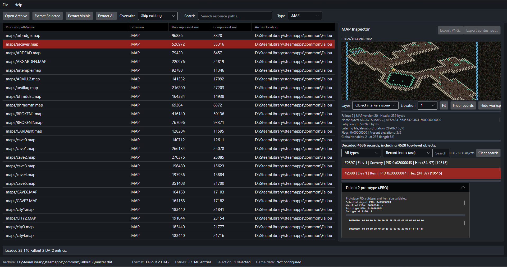
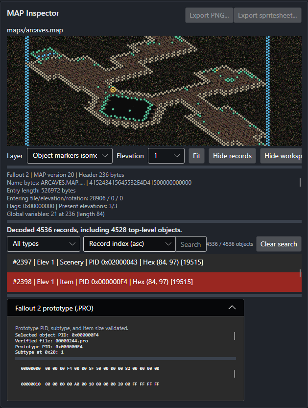

[](https://github.com/Venomsky/Fallout-Asset-Explorer/actions/workflows/build-and-test.yml)

# Fallout Asset Explorer

## Explore the files behind the wasteland.

A desktop tool for exploring the files behind Fallout 1 and Fallout 2. Browse game archives, preview graphics and animations, export PNGs, inspect map data, and extract assets for modding or further research.

**No archive-format expertise required.** Open a game archive on your computer and start exploring. The app does not bundle game assets or modify your archives.



## Why use it?

- Find resources by path, search text, or file type instead of manually digging through archive contents.
- Preview supported Fallout graphics and export a frame or a complete FRM spritesheet as PNG.
- Inspect map grids and placed-object records without mistaking diagnostic views for an in-game rendering.
- Examine supported Fallout 2 prototype records, or extract files for your own tools and workflows.

## What you can do

### Browse, search, and extract

Open Fallout 1 DAT1 or Fallout 2 DAT2 archives to browse their entries. Search paths, filter by extension, sort the list, and select one or more files. Extract selected entries, the currently visible (filtered) entries, or everything in the archive. Extraction includes path validation, overwrite choices, and cancellation.

### Preview and export graphics

Preview combined `.FRM` animation files, choose a direction and frame, and play or loop the animation at an adjustable preview speed. A checkerboard helps reveal transparent pixels. Export the selected frame as a PNG or export the animation as a spritesheet PNG with frame metadata.

Color previews use a Fallout palette when one can be found in the archive or a configured game-data folder. If a palette is unavailable, the app labels and displays diagnostic grayscale; color PNG export is then unavailable. Split critter animations (`.FR0`–`.FR5`) are not supported.

### Explore maps and prototypes

The Map Editor tab hosts the MAP inspection and editing workspace. It exposes supported header data, raw tile-grid values, object placements, and several diagnostic views. You can choose a layer and elevation, and search, filter, sort, and select decoded object records. A supported nested inventory quantity can be edited and saved as a separate MAP file when the complete source-bound decode is eligible. Save As patches only that quantity's four source bytes; it does not modify the archive or provide general MAP serialization. Fallout 2 floor-art lookup is available from a Fallout 2 DAT2 archive. Some map-record layouts cannot yet be decoded; the editor reports partial or unsupported data rather than treating every map as fully understood.

Select a Fallout 2 `.PRO` entry to inspect supported Item and Scenery records directly, view parsed fields and raw bytes, export a report, or save the original bytes as BIN. This standalone view does not verify the record through a MAP PID or prototype list. Other PID types and unsupported subtypes may show raw data without decoded fields.

## Format support

| Format | Current support | Limitations |
| --- | --- | --- |
| Fallout 1 DAT1 | Browse, search, preview supported FRM entries, and extract files. | Archive reading is read-only; support is limited to validated DAT1 structures and supported entry encodings. |
| Fallout 2 DAT2 | Browse, search, preview supported FRM/MAP/PRO entries, and extract files. | Archive reading is read-only; support is limited to validated DAT2 structures and supported entry encodings. |
| FRM | Preview combined `.FRM` animations; export a frame or spritesheet as PNG. | Split `.FR0`–`.FR5` critter animations are unsupported. Color export needs a resolved palette; game-accurate palette matching and animation timing are not claimed. |
| MAP | Partial inspection, in-memory inventory-quantity editing, and constrained Save As for eligible complete maps. | Fallout 1 version 19 and Fallout 2 versions 19 and 20 headers are recognized. Save As patches only the four-byte quantity field for supported nested inventory edits and rejects incomplete or unsupported layouts; it is not a general MAP serializer. Object parsing can stop at an unsupported layout. Fallout 2 floor-art lookup needs a Fallout 2 DAT2 archive; the isometric floor view is experimental. This is not a complete game renderer, and scripts are not interpreted. |
| PRO | Partial semantic inspection of selected records in Fallout 2 DAT2 archives. | Item and Scenery PID types are decoded; unsupported PID types or subtypes retain raw bytes without full field interpretation. Fallout 1 PRO semantic inspection is not implemented. PRO export controls and the generated report are in English. |
| Other archive entries | Browse, search, filter, and extract. | No in-app preview is provided for other file types. |

The archive readers validate structure and bound entry reads. The app also limits MAP previews to 64 MiB and standalone PRO previews to 1 MiB. These safeguards do not establish compatibility with every release, mod, or archive variant.

## MAP Inspection

Inspect supported MAP header data, elevation grids, and decoded object records. Switch between grid and marker diagnostic layers, search, filter, and sort records, and inspect selected object details. Fallout 2 floor-art lookup requires a Fallout 2 DAT2 archive.

The isometric views are diagnostic and experimental, not a full Fallout 2 renderer. Both `Floor tiles isometric` and `Object markers isometric` can render multiple eligible Item, Scenery, and Wall sprites on the selected elevation. Object markers and their selection/hover interactions are available only in `Object markers isometric`. Results may be partial if MAP object decoding stops at an unsupported layout or individual sprite resources cannot be prepared. The per-map object-sprite bitmap cache is limited to 64 MiB; sprites that do not fit in the remaining budget are not prepared, while their markers remain visible.

Sprite draw order currently follows input MAP placement order and has not been verified against the original game. FRM frame offsets (`FrmFrame.OffsetX/Y`) are retained for diagnostics but are not applied to sprite geometry. The offscreen test checks pixel composition and transparency for the current input order; it does not establish visual or draw-order compatibility with Fallout 2.



## Getting started

The application targets **.NET 10** and uses Avalonia for its desktop interface. To run it from source, you need the .NET 10 SDK and a desktop environment. No game files are bundled, and no archive is needed just to start the app.

From the repository root, run:

```powershell
dotnet run --project src\FalloutAssetExplorer.App\FalloutAssetExplorer.App.csproj
```

Choose **Open Archive** in the app to select a local `.dat` file. The archive format is detected from its validated structure, not just its filename extension.

For a prebuilt Windows x64 release, download `FalloutAssetExplorer-win-x64.zip` from the project's GitHub Releases page, extract the ZIP, and launch `FalloutAssetExplorer.App.exe`. The release is self-contained and does not require a separate .NET runtime installation. No game files are bundled.

## Development status

The project is actively developed. Its current focus is read-only archive browsing, asset previews, extraction, and diagnostic inspection—not editing game archives or providing a full game renderer. MAP object decoding and Fallout 2 PRO field interpretation remain partial; see the format table above.

There is no formal roadmap in the repository, so possible future work is not presented here as a commitment.

## Development and contribution

The solution contains the Avalonia desktop app, a shared core library, and xUnit tests. There is no separate contribution guide in the repository. To build and run the tests from the repository root:

```powershell
dotnet build FalloutAssetExplorer.sln
dotnet test FalloutAssetExplorer.sln
```

Most format tests use synthetic data to exercise valid and malformed inputs. Optional diagnostics against real Fallout 2 maps run only when `FALLOUT2_MASTER_DAT` points to a local Fallout 2 `master.dat` archive.

For the investigation notes and their source references, see [DAT format notes](docs/dat-format-investigation.md) and [MAP format notes](docs/map-format-investigation.md).

## License and attribution

This project is licensed under the MIT License; see [LICENSE](LICENSE) for the full terms. Fallout 1 and Fallout 2 are trademarks of their respective owners. Fallout Asset Explorer is an unofficial community project and is not affiliated with, endorsed by, or sponsored by Bethesda Softworks or its affiliates. The format investigation documents include their technical source references.
